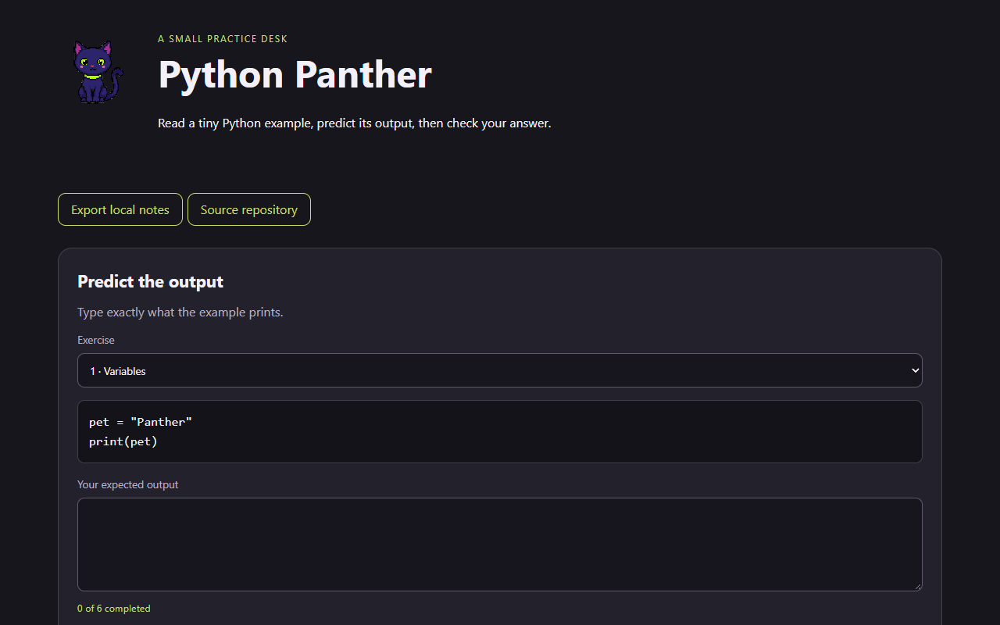

# LearnPython

## Pictures

Python Panther's [program page](https://findastra.github.io/astras-pet-os/apps/learn-python-20261008.html) as published in Astra's PetOS.

Screenshots taken 2026-10-17 with GitHub Goldfish's [project-image-generator](https://github.com/findastra/github-goldfish#project-image-generator); added with Claude Opus 5.5 (`claude-opus-5-5`), 2026-10-17.

## Python Panther pet interface

*A pet app by Astra.*

Open [learn-python-20261008.html](learn-python-20261008.html) in a modern browser, or double-click Python Panther in Astra's Pet Apps. The nine original pet moods and manifest are included.

Limits: this browser interface does not install or start native programs. Where an existing web app is available, the Cage opens that app. Draft controls store their data in the current browser and do not imply connected services. Existing application instructions above still apply.

Version [v0.1.0-20261008-pets](https://github.com/findastra/learn-python/tree/v0.1.0-20261008-pets). Added with OpenAI Codex (GPT-6), 2026-10-08.

Desktop appearance draft updated 2026-10-11: see [desktop details](desktop-pet-20261011.json). This changes the desktop pet, not application features.
